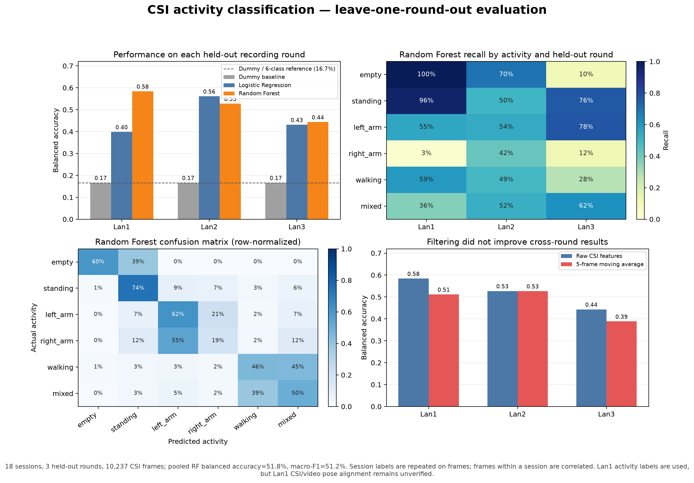

# CSI activity-classification results

## What was evaluated

The experiment uses 18 session recordings (six activity labels per round,
three rounds) and 10,237 complete CSI feature frames. Each evaluation holds
out every session from one complete recording round, trains on the other two,
and repeats for Lan1, Lan2, and Lan3. The selected Random Forest uses seven
frame-level and temporal CSI features. A most-frequent Dummy classifier and
Logistic Regression are included as baselines.

The activity label is assigned at the session level and copied to its CSI
frames. This experiment evaluates whether CSI features distinguish the
recorded session categories across rounds; it does not locate the exact
start/end of each movement. It uses no video or pose labels, so Lan1's
unverified CSI/video pose alignment does not invalidate this activity-only
evaluation. Lan1 must still remain excluded from pose-supervised training
unless its alignment is verified.

## Main chart



Regenerate from the project root:

```powershell
python machine-learning/src/plot_activity_round_experiment.py
```

The script saves the chart as
`machine-learning/results/activity-round-experiment/round-heldout-comparison/activity_round_results.png`.

## Results

| Model / signal | Lan1 held out | Lan2 held out | Lan3 held out | Pooled balanced accuracy | Pooled macro-F1 |
|---|---:|---:|---:|---:|---:|
| Random Forest, raw features | 58.4% | 52.7% | 44.4% | 51.8% | 51.2% |
| Logistic Regression, raw features | 39.9% | 56.1% | 43.2% | 46.3% | 46.4% |
| Dummy baseline | 16.7% | 16.7% | 16.7% | 16.4% | 11.0% |
| Random Forest, 5-frame moving average | 51.2% | 52.7% | 38.9% | 47.6% | 48.2% |

The raw-feature Random Forest beats the Dummy baseline in all three held-out
rounds, which is evidence of activity-related information in this dataset.
Its balanced accuracy falls by 14 percentage points from the best to worst
held-out round, so this is not yet a reliable general-purpose activity
detector. Five-frame smoothing did not improve performance.

Random Forest per-class recall varies substantially by held-out round:

| Activity | Lan1 | Lan2 | Lan3 | Mean across rounds |
|---|---:|---:|---:|---:|
| Empty | 100.0% | 69.8% | 10.4% | 60.1% |
| Standing | 96.0% | 50.2% | 76.5% | 74.2% |
| Left arm | 55.4% | 53.5% | 77.5% | 62.2% |
| Right arm | 3.1% | 41.8% | 11.6% | 18.9% |
| Walking | 59.4% | 49.0% | 27.8% | 45.4% |
| Mixed | 36.5% | 52.0% | 62.2% | 50.3% |

This indicates some activity discrimination, but the model is particularly
weak and inconsistent for `right_arm`, and its `empty` recall changes sharply
between rounds. Results must be reported with the per-round and per-class
breakdown rather than only the pooled score.

## Interpretation and limitations

- The 10,237 frames are not 10,237 independent experiments; neighboring frames
  from each recording are temporally related. There are only three held-out
  recording rounds.
- These are session-level activity labels repeated on frames, not verified
  frame-level movement labels. Do not claim exact real-time action boundaries.
- The experiment supports the limited statement that the current CSI features
  contain information useful for distinguishing some recorded activity
  categories across these rounds. It does not establish a dependable deployed
  detector or generalization to new people, rooms, receiver placement, or
  hardware.
- It does not test pose prediction, people counting, gender, or height.
- The activity-only result is distinct from the CSI-to-pose result. On the
  verified Lan2/Lan3 pose subset, the current CSI-conditioned Ridge model did
  not beat the mean-pose baseline.

Compact source metrics are retained alongside this report:
`round_heldout_metrics.csv`, `per_round_metrics.csv`,
`per_class_recall.csv`, and `experiment_metadata.json`. The larger
frame-level `round_heldout_predictions.csv` is not distributed. Reproducing
the evaluation requires obtaining compatible CSI inputs and rerunning the
documented pipeline.
