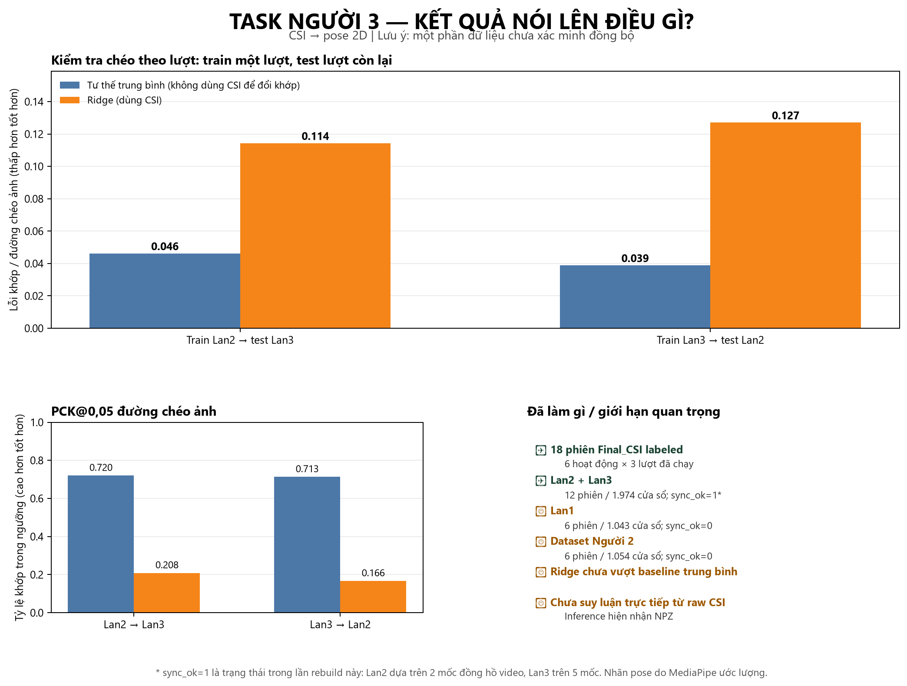

# Báo cáo bàn giao — Task Người thứ 3

## Trả lời nhanh

- **Đã chạy đủ sáu hoạt động của cả ba lượt trên dữ liệu `labeled` trong `Final_CSI`: 18/18 phiên.** Sáu hoạt động gồm `empty`, `standing`, `left_arm`, `right_arm`, `walking`, `mixed`.
- Đã parse CSI, trích pose từ video, ghép cửa sổ, huấn luyện/evaluate riêng từng lượt; đồng thời huấn luyện trên Lan2+Lan3 và chạy kiểm tra chéo giữa hai lượt.
- Đã audit lại video Lan2 sau khi khôi phục `Final_CSI`: đồng hồ laptop hiện rõ tại đầu video (00:00:00, 11:07:48.138), mốc kiểm tra 00:00:05 (11:07:53.136), và cuối video (00:10:14.8, 11:18:02.938).
- Đã dùng thêm bộ `pose_windows_dataset` hiện có của Người 2. Bộ nguồn không bị sửa; kết quả train được ghi sang thư mục khác.
- Thử nghiệm activity-only giữ nguyên một lượt làm test cho thấy CSI vượt baseline đoán tần suất (balanced accuracy Random Forest 0,518 so với 0,164), nhưng kết quả dao động theo lượt và chưa đủ tin cậy; moving average còn làm điểm giảm.
- Đã thêm và smoke-test đường suy luận offline từ thư mục capture `raw.csi` đã lưu đến CSV dự đoán; phiên Lan3 `left_arm` tạo 184 cửa sổ hợp lệ.
- **Chưa thể kết luận Task 3 hoàn tất theo nghĩa có mô hình CSI dự đoán tư thế chuyển động đáng tin cậy.** Bộ `pose_windows_dataset` của Người 2 và toàn bộ Lan1 đều có `sync_ok=0`; ở Lan2/Lan3, baseline tư thế trung bình lại tốt hơn Ridge. Mô hình được chọn vì vậy không chứng minh CSI đang dự đoán chuyển động của khớp.
- Đối chiếu SHA-256 xác nhận 12 bản `raw.csi` trong video-session của Lan2/Lan3 là bản sao của các phiên `labeled`, không phát hiện phiên bổ sung.

**Phạm vi tải về:** repo chứa mã nguồn, tests, báo cáo, metric tóm tắt,
model baseline và hình nghiên cứu. Capture CSI/video gốc, CSV/NPZ trung gian,
prediction tables lớn và video minh họa không được đưa lên Git; muốn chạy lại
pipeline cần lấy dữ liệu tương thích riêng.

## Đã chạy những gì?

| Bộ dữ liệu | Phiên đã xử lý | Cửa sổ CSI–pose | Tình trạng đồng bộ | Kết quả |
|---|---:|---:|---|---|
| Lan1 từ `Final_CSI/labeled` | 6/6 hoạt động | 1.043 | `sync_ok=0`; offset chỉ ước lượng từ giờ bắt đầu được báo lại | Đã train/evaluate chẩn đoán, không dùng làm kết quả pose đã xác minh |
| Lan2 từ `Final_CSI/labeled` | 6/6 hoạt động | 991 | `sync_ok=1`; ba mốc laptop nhìn thấy ở 0, 5 và 614,8 giây, fit residual tối đa 1,009 ms; video giải mã đủ và rà mẫu 1 Hz | Đã train/evaluate |
| Lan3 từ `Final_CSI/labeled` | 6/6 hoạt động | 983 | `sync_ok=1`; năm mốc phone-clock nhìn thấy và clock log; video giải mã đủ và rà mẫu 1 Hz | Đã train/evaluate |
| Lan2 + Lan3 | 12 phiên | 1.974 | Chỉ gồm các cửa sổ `sync_ok=1` | Đã train/evaluate |
| `pose_windows_dataset` Người 2 đang có trong workspace | 6 phiên, đều là repeat `01` | 1.054 cửa sổ được nạp | Cả sáu phiên `sync_ok=0`; offset trong summary là 0 | Đã đọc và chạy chẩn đoán riêng; không dùng làm đánh giá pose đã đồng bộ |

Vì vậy, câu trả lời cho “đã chạy hết mọi hoạt động, mọi phiên ở Lan1/Lan2/Lan3 chưa?” là: **đã chạy đủ 18 phiên `labeled` của ba lượt, mỗi lượt đủ sáu hoạt động**. Bộ windows Người 2 hiện có trong workspace chỉ chứa sáu phiên Lan1; không phải bộ ba lượt.

## Kiểm chứng timeframe và đồng bộ (đối chiếu lại ngày 10/11/2026)

Người dùng xác nhận Lan2/Lan3 được quay cùng thứ Năm 05/11/2026. Timestamp bên trong CSI và clock log cho thấy các khoảng cụ thể sau; đây là thời điểm của các capture CSI, không phải toàn bộ thời lượng buổi làm việc:

| Lượt | Khoảng CSI theo đồng hồ tại máy thu | Bằng chứng video/clock | Kết luận dùng cho pose |
|---|---|---|---|
| Lan1 | 03/11, khoảng 14:53:03–15:02:11 giờ Việt Nam | Phiếu và người thu xác nhận chủ ý bấm Enter và nút quay điện thoại gần như đồng thời; có mốc bắt đầu video được báo lại và các mốc CSI, nhưng thời điểm first-frame chưa được đối chiếu độc lập | `sync_ok=0`, dùng chẩn đoán cho pose |
| Lan2 | 05/11, 11:08:54–11:17:36, UTC+07 | Video 615,83 giây; clock nhìn thấy ở 0 giây = 11:07:48.138, 5 giây = 11:07:53.136, và 614,8 giây = 11:18:02.938. Fit ba mốc có residual tối đa 1,009 ms, drift ước tính 0,992 ms. `session-clock.csv` có 12.815 dòng; toàn bộ video đã giải mã 18.475/18.475 frame, sau đó rà 616 mẫu hình ở 1 Hz cho thấy nội dung sáu đoạn CSI phù hợp nhãn | Giữ `sync_ok=1`; clock và kiểm tra hoạt động được củng cố, nhưng 1 Hz không phải rà thủ công mọi frame/pose |
| Lan3 | 05/11, 11:29:44–11:38:27, UTC+07 | Video 579,9 giây; năm mốc phone-clock nhìn thấy trải từ 30 đến 578,9 giây; residual lớn nhất 6,774 ms, drift ước tính khoảng 10,891 ms | Dùng `sync_ok=1` cho cửa sổ Lan3 |

Clock log chứng minh đồng hồ hiển thị và host của bộ thu đi gần nhau; bản thân clock log không thay thế mốc nhìn thấy trong video. Lan2 hiện có ba mốc đọc được ở 0, 5 và 614,8 giây; sai số khớp dưới 2 ms và các mẫu hình thưa xác nhận nội dung sáu đoạn theo CSI. Tuy vậy, hai mốc đầu nằm gần nhau; nếu áp dụng nghiêm checklist yêu cầu tối thiểu năm mốc phân bố đều thì Lan2 chưa đạt số lượng đó. Chi tiết từng đoạn và ảnh mẫu: [LAN2_VIDEO_AUDIT.md](../../activity-round-experiment/Lan2-video-audit/LAN2_VIDEO_AUDIT.md).

**Thông tin bổ sung về Lan1:** phiếu điền sau buổi thu ghi video bắt đầu lúc 02:52:28 theo đồng hồ laptop và nêu các giờ bắt đầu CSI. Ngày 11/11, người thu làm rõ đã chủ ý bấm Enter và nút quay điện thoại gần như cùng lúc để khởi động hai quy trình. Đây là lời xác nhận trực tiếp hữu ích, không phải bằng chứng rằng đã xảy ra một độ trễ; nhưng thời điểm hai thao tác/frame đầu không được đo hoặc ghi lại bằng mốc chung. Các timestamp CSI tuyệt đối của sáu hoạt động, đổi sang giờ Việt Nam, nằm trong khoảng 14:53:03.855–15:01:11.666. Như vậy có thể dùng ánh xạ được báo lại để rà soát/thử nghiệm thăm dò, nhưng chưa chứng minh sai số đồng bộ <=100 ms.

**Đối chiếu bổ sung Lan2 ngày 10/11:** đã đọc ba giờ laptop trong video và fit với sai số tối đa 1,009 ms; toàn bộ clip 615,83 giây được giải mã tuần tự (18.475/18.475 frame) và rà 616 mẫu hình 1 Hz. Các mẫu trong sáu đoạn CSI phù hợp tổng quát với nhãn hoạt động; ghi nhận đoạn `standing` có vài cử động tay/thân trên ngắn ở đầu nhưng người vẫn đứng tại chỗ. Đây củng cố `sync_ok=1`; không có nghĩa từng frame hay từng pose được người xem thủ công. Lượt giải mã mất 52,7 phút, CPU tiến trình trung bình 28,0% của một logical CPU (CPU toàn hệ thống lấy mẫu trung bình 16,2%), working set đỉnh 232,2 MB. Chi tiết, resource log và contact sheet: [LAN2_VIDEO_AUDIT.md](../../activity-round-experiment/Lan2-video-audit/LAN2_VIDEO_AUDIT.md).

**Đối chiếu bổ sung Lan1 ngày 10/11:** đã giải mã tuần tự tới cuối sáu clip hoạt động (mỗi clip 59–60 giây) và video tổng `RNZD8449.MOV` (593,7 giây). Đã rà contact sheet lấy 1 khung/giây cho cả bảy video; đây là xem hình mẫu thưa sau khi giải mã đầy đủ, không phải xem thủ công mọi frame. Các mẫu video tổng cho thấy phòng trống lúc đầu, người xuất hiện khoảng giây 110 và các giai đoạn đứng/nâng tay/di chuyển về sau; không xác định chính xác ranh giới hoạt động từ mẫu 1 Hz. Phiếu bổ sung và người thu xác nhận hai quy trình quay được khởi động gần như đồng thời, cung cấp mốc gần đúng hữu ích. Thời điểm thao tác/frame đầu không được đo độc lập. Tương quan chuyển động trên sáu clip riêng có ROI r từ 0,074 đến 0,616; ngay clip walking, đỉnh phụ 0,570 gần đỉnh 0,616. Vì vậy bằng chứng hiện có **chưa đủ để đổi Lan1 sang `sync_ok=1`**; cờ này chỉ nói sai số ánh xạ CSI–video chưa được định lượng/kiểm chứng độc lập, không nói CSI/video thiếu hay hỏng. Chi tiết và contact sheet: [LAN1_VIDEO_AUDIT.md](../../activity-round-experiment/Lan1-video-audit/LAN1_VIDEO_AUDIT.md).

**Đối chiếu bổ sung Lan3 ngày 10/11:** toàn bộ video `UCZS0429.MOV` được giải mã tuần tự (17.397/17.397 frame) và rà 580 mẫu hình ở 1 Hz. Các mẫu sáu đoạn CSI phù hợp tổng quát với `empty`, `standing`, nâng tay trái/phải, `walking` và `mixed`; đây không phải gán mốc chuyển động/frame chính xác. CPU tiến trình trung bình 28,0% của một logical CPU (CPU toàn hệ thống lấy mẫu trung bình 16,3%), working set đỉnh 232,6 MB; thời gian giải mã 55,5 phút. Chi tiết, resource log và contact sheet: [LAN3_VIDEO_AUDIT.md](../../activity-round-experiment/Lan3-video-audit/LAN3_VIDEO_AUDIT.md).

Trong `Final_CSI`, Lan2 và Lan3 còn sáu bản sao `raw.csi` dưới mỗi `video-sessions`. Đối chiếu SHA-256 theo lượt xác nhận cả 12 bản sao trùng với `labeled`; không cộng chúng thành phiên mới.

## Quy trình dữ liệu và sản phẩm

Với 18 phiên `labeled`, pipeline đã làm:

1. Tạo index phiên từ metadata/ghi chú và liên kết tới CSI, video.
2. Parse `raw.csi` thành CSV amplitude. Tổng 19.575 frame được parser đọc; 10.237 frame giữ lại, 9.338 frame bị loại theo quy tắc parser. Không có timestamp đi lùi trong metadata parse.
3. Trích 10.932 frame pose từ các đoạn video ứng với CSI; đây là **nhãn giả (pseudo-labels) do MediaPipe ước lượng từ video**, không phải ground truth motion-capture.
4. Ghép cửa sổ 2 giây, bước trượt 0,2 giây, kích thước đầu vào 20 × 224; lưu CSI, tọa độ khớp, visibility/mask, session, hoạt động và timestamp.
5. Train/test theo leave-one-session-out; chạy thêm đánh giá huấn luyện một lượt và kiểm tra trên lượt kia (Lan2→Lan3, Lan3→Lan2).
6. Chạy inference trên windows NPZ và đo thời gian dự đoán của riêng model.
7. Tạo video minh họa so sánh nhãn pose video với dự đoán của mean-pose baseline trên phiên Lan3 bị giữ lại.
8. Thêm `predict_pose_session.py`: parse VHT từ một thư mục capture đã lưu, tạo cửa sổ 2 giây/bước 0,2 giây, loại cửa sổ cắt qua gap trên 300 ms, rồi xuất NPZ và CSV dự đoán. Smoke test từ CSI Lan3 `left_arm` cho 184 cửa sổ; 87 cửa sổ bị loại do gap.

## Kết quả mô hình: điều quan trọng cần nói khi bàn giao



Metric lỗi tọa độ được chuẩn hóa theo đường chéo ảnh; PCK dùng ngưỡng 0,05 đường chéo ảnh.

| Tập đánh giá | Mean-pose: lỗi / PCK | Ridge: lỗi / PCK | Ghi chú |
|---|---:|---:|---|
| Lan1 — chẩn đoán, đồng bộ chưa xác minh | 0,0359 / 0,7060 | 0,0574 / 0,6974 | Không phải metric pose hợp lệ do `sync_ok=0` |
| Lan2 — leave-one-session-out | 0,0409 / 0,7039 | 0,0557 / 0,7148 | Sáu phiên, một người thu |
| Lan3 — leave-one-session-out | 0,0457 / 0,7053 | 0,0879 / 0,4333 | Sáu phiên, một người thu |
| Lan2 + Lan3 — leave-one-session-out | 0,0423 / 0,7143 | 0,0579 / 0,5521 | 12 phiên, train lại từ bộ windows đã kiểm chứng |
| Train Lan2, test Lan3 | 0,0462 / 0,7198 | 0,1143 / 0,2083 | Kiểm tra nguyên lượt độc lập |
| Train Lan3, test Lan2 | 0,0389 / 0,7128 | 0,1271 / 0,1663 | Kiểm tra nguyên lượt độc lập |
| `pose_windows_dataset` Người 2 — chẩn đoán | 0,03745 / 0,69882 | 0,04858 / 0,69875 | Cả sáu phiên `sync_ok=0` |

Mô hình chọn `training_mean` vì có lỗi thấp hơn Ridge. Mean-pose chỉ dự đoán tư thế trung bình đã học, không dùng CSI để thay đổi tọa độ khớp theo chuyển động. Do đó **chưa có cơ sở để báo cáo rằng CSI hiện dự đoán được bộ xương chuyển động tốt**.

Độ chính xác/F1 phát hiện có người cũng cần thận trọng: balanced accuracy Lan2+Lan3 là **0,5042**, nên accuracy/F1 cao không đủ chứng minh khả năng tổng quát hóa tốt.

Để trực quan hóa theo dạng skeleton mẫu và metric theo hoạt động, xem
[held-out walking pose examples](./combined-verified/training/heldout_walking_pose_examples.png)
và [verified pose metric dashboard](./combined-verified/training/verified_pose_metric_dashboard.png).
Các skeleton ở hình đầu lấy từ cùng bốn cửa sổ của phiên Lan3 `walking` được giữ
lại khi train trên Lan2: video pseudo-label, CSI Ridge, và `training_mean`.
Đây là hình minh họa lỗi mô hình, không phải bằng chứng đủ rằng Ridge tổng quát hóa.
Trong per-session activity summary Ridge có lỗi thấp hơn mean-pose ở `walking`
và `mixed`, nhưng phép test giữ nguyên cả lượt cho thấy Ridge kém hơn rõ; xem
ma trận kết quả bên cạnh trước khi diễn giải vài khung minh họa.
Lệnh tạo lại cả hai hình:

```powershell
python machine-learning/src/plot_verified_pose_comparison.py
```

Hình ảnh và metric làm kết quả dễ kiểm tra hơn, nhưng không tự cải thiện mô hình.
Muốn cải thiện cần thay đổi/huấn luyện mô hình trên dữ liệu pose đã đồng bộ,
rồi đánh giá lại bằng split giữ nguyên phiên/lượt; không được chọn vài khung
hình đẹp làm bằng chứng thay cho metric toàn tập.

### Train lại và suy luận capture raw (10/11/2026)

Đã train lại bằng đúng 12 phiên/1.974 cửa sổ `sync_ok=1`, giới hạn một CPU worker. Kết quả mới khớp với lần trước: mean-pose lỗi **0,042264**, Ridge lỗi **0,057914**, presence balanced accuracy **0,5042**. Model, split theo phiên, OOF predictions, metric và snapshot lần chạy được lưu tại `retrained-verified-lan2-lan3-20261110/`; model có `diagnostic_only=false` nhưng vẫn là prototype cho một người/setup và nhãn pose giả.

Đường chạy từ capture CSI đã lưu được thử trên Lan3 `left_arm`: 561 frame VHT đầu vào, 87 cửa sổ loại do gap, 184 cửa sổ dự đoán. Lần chạy này mất 0,263 giây parse/tạo cửa sổ, 0,145 giây ghi NPZ, 0,210 giây load model/inference/ghi CSV và 0,619 giây tổng cộng trên máy hiện tại; xem sidecar JSON để biết số đo của lần chạy cụ thể. Đây là smoke-test trên một phiên đã tham gia huấn luyện, không phải phép đo chất lượng trên tập test độc lập. Lệnh:

```powershell
python machine-learning/src/predict_pose_session.py `
  --input-session "D:\CSI values\Final_CSI\csi-data-lan3-20261110T090525Z-1-001\csi-data-lan3\labeled\test_2026110511321713388_20261105-113219_unjU" `
  --output machine-learning/results/pose-sync-check/final-csi-rebuild/inference-smoke-lan3-left-arm/predictions.csv
```

Kết quả smoke-test và sidecar thời gian parse/window, lưu NPZ, inference+CSV, tổng thời gian nằm trong `inference-smoke-lan3-left-arm/`. Đây là kiểm tra tương thích pipeline trên capture đã dùng cho train, không phải đánh giá trên phiên test mới. Chương trình chưa nhận luồng receiver trực tiếp.

### Thử nghiệm phân loại hoạt động theo lượt quay (10/11/2026)

Để kiểm tra CSI có chứa tín hiệu nhận biết hoạt động hay không, đã chạy riêng pipeline đặc trưng CSI trên 18 phiên `labeled` của Lan1/Lan2/Lan3: **10.237 frame**, nhịp lấy mẫu khoảng 101 ms, đủ 224 mẫu/frame và không có frame thiếu mẫu trong các CSV parse. Lan1 được đưa vào thử nghiệm này vì nhãn hoạt động gắn với cả phiên, không cần đồng bộ video; điều đó **không** làm thay đổi trạng thái `sync_ok=0` của Lan1 trong bài toán ghép pose.

Đánh giá dùng leave-one-round-out: mỗi lần giữ nguyên cả một lượt quay làm test và chỉ huấn luyện trên hai lượt còn lại. Với đặc trưng frame + temporal, Random Forest đạt balanced accuracy **0,518** / macro-F1 **0,512** trên ba lượt gộp; Logistic Regression đạt balanced accuracy **0,463**. Baseline đoán theo tần suất đạt balanced accuracy **0,164**. Random Forest theo từng lượt test có balanced accuracy 0,584 (Lan1), 0,527 (Lan2), 0,444 (Lan3), nên kết quả vẫn dao động và có lớp dự đoán rất kém. Đây là dấu hiệu CSI có ích cho **phân loại hoạt động ở mức phiên**, nhưng chưa phải độ chính xác đủ để gọi là detector đáng tin cậy.

Đã so sánh đặc trưng từ biên độ CSI thô với moving average 5 frame. Bộ lọc giảm jitter cao tần trung bình **69,4%**, nhưng chỉ giữ khoảng **64,3%** độ biến thiên temporal; balanced accuracy Random Forest giảm từ **0,518** xuống **0,476**. Vì vậy lọc mượt hơn không đồng nghĩa phân loại tốt hơn. Bộ lọc hiện là centered/offline, dùng cả frame tương lai nên chưa được dùng trực tiếp cho suy luận live.

Phép thử hoạt động **không dùng video làm đầu vào**: nhãn `empty`, `standing`, `left_arm`, `right_arm`, `walking`, `mixed` được gán cho mọi frame trong phiên. Đây chưa phải nhãn sự kiện chính xác từng thời điểm; video và pose từ video vẫn cần dùng ở bước tiếp theo để tạo pseudo-label theo thời gian, sau khi kiểm chứng ghép CSI–video. Kết quả CSV/JSON và đặc trưng đã tiền xử lý nằm ở `machine-learning/results/activity-round-experiment/`; chi tiết holdout ở `round-heldout-comparison/`.

Biểu đồ gồm balanced accuracy theo lượt, recall theo hoạt động, confusion matrix và so sánh raw/filter được lưu tại [activity_round_results.png](../../activity-round-experiment/round-heldout-comparison/activity_round_results.png). Diễn giải và bảng recall đầy đủ nằm trong [ACTIVITY_CLASSIFICATION_RESULTS.md](../../activity-round-experiment/round-heldout-comparison/ACTIVITY_CLASSIFICATION_RESULTS.md).

## Đối chiếu checklist Task Người 3

| Hạng mục | Trạng thái | Ghi chú |
|---|---|---|
| Chốt phạm vi, đầu vào/đầu ra và tiêu chí với cả nhóm | **Chưa xác nhận hoàn tất** | Có dùng phạm vi kỹ thuật một người, pose 2D; chưa có biên bản xác nhận của nhóm |
| Kiểm tra schema và đọc được dữ liệu Người 2 | **Đã làm** | Đã đọc cả sáu NPZ và chạy chẩn đoán; cả sáu có `sync_ok=0`, nên không đưa vào train/test pose chính |
| Chia dữ liệu độc lập theo phiên, tránh rò rỉ cửa sổ chồng lấn | **Đã làm** | Leave-one-session-out và hai phép train/test nguyên lượt |
| Baseline, so với mean-pose, lưu model/metric | **Đã làm** | Ridge thua mean-pose trong các phép thử chính |
| Inference xuất trạng thái và tọa độ pose | **Đã làm offline** | Có `predict_pose.py` cho NPZ và `predict_pose_session.py` cho capture CSI đã lưu; chưa phải luồng live |
| Video đối chiếu, latency | **Đã làm một phần** | Có video minh họa; raw-capture smoke test đo parse/window, lưu NPZ và model/CSV nhưng chưa đo live stream |
| Đánh giá độc lập đủ để kết luận mô hình dùng được | **Chưa đạt** | Ít phiên, một người thu; phần lớn bằng chứng pose không cho thấy lợi ích của CSI |
| Chương trình chạy từ một capture `raw.csi` đã lưu tới kết quả | **Đã làm và smoke-test** | Đã parse, tạo windows và xuất CSV dự đoán trên phiên Lan3 `left_arm` |
| Kiểm tra CSI phân loại sáu hoạt động khi giữ nguyên cả lượt làm test | **Đã làm, kết quả sơ bộ** | 18 phiên/10.237 frame; Random Forest balanced accuracy 0,518, thấp và dao động theo lượt |
| Kiểm tra clock/video và ánh xạ sáu capture Lan2 | **Đã làm, xác nhận thêm** | Fit ba mốc clock residual tối đa 1,009 ms; lấy mẫu thưa đầu/giữa/cuối từng capture, không giải mã cả clip |
| Tích hợp receiver CSI live, backend/frontend và kiểm soát trạng thái lỗi end-to-end | **Chưa hoàn tất** | Chưa có nguồn CSI live/ứng dụng tích hợp để kiểm thử trên máy chạy thật |
| Gender/chiều cao thật | **Ngoài phạm vi dữ liệu hiện có** | Không có nhãn ground truth giới tính hay chiều cao thực |

**Kết luận trạng thái theo đúng phạm vi:** phần triển khai nghiên cứu của Người 3 đã hoàn thành ở mức pipeline offline, baseline, đánh giá độc lập theo session/lượt, inference từ capture đã lưu, artifact và tài liệu bàn giao. Kết quả đánh giá cũng cho thấy mục tiêu cốt lõi **CSI dự đoán pose chuyển động tốt hơn baseline chưa đạt**: trên Lan2/Lan3, Ridge thua pose trung bình. Vì vậy không nên báo cáo “mô hình pose đã hoạt động đáng tin cậy” hoặc “đã hoàn tất tích hợp sản phẩm”.

Theo điều kiện hoàn thành trong phiếu giao việc, Task 3 chỉ được chốt hoàn toàn sau khi nhóm có thể chạy lại mô hình, xem kết quả đánh giá độc lập, tích hợp được giao diện dữ liệu và thống nhất tiêu chí sai số/độ trễ với nhóm/giảng viên. Các mục chạy lại, đánh giá và mô tả giới hạn đã có; giao diện hiện là đầu ra offline CSV/NPZ, chưa tích hợp receiver/backend/frontend live; chưa tìm thấy biên bản xác nhận tiêu chí đạt. Do đó trạng thái chính xác là **đã hoàn tất phần nghiên cứu và bàn giao kỹ thuật; còn mở phần nghiệm thu mô hình pose và tích hợp live**. Đây là kết luận về bằng chứng hiện có, không có nghĩa task bất khả thi.


## File và thư mục kết quả

Thư mục gốc của lần dựng lại:

Repo công bố tài liệu tại `machine-learning/results/pose-sync-check/` và
`machine-learning/results/activity-round-experiment/`. Trong
`final-csi-rebuild/`, các artifact chính được phát hành là:

- `sync_summary_public.csv`, `video_clock_anchors.csv`,
  `clock_quality.json`: tóm tắt đồng bộ và clock; bảng đồng bộ đã lược bỏ
  đường dẫn file riêng trên máy.
- `combined-verified/training/pose_baseline.joblib` và
  `model_metadata_public.json`: model baseline cùng metadata đã lược định danh.
- `combined-verified/training/summary_metrics.csv` và hai bảng
  `cross-round-*/metrics.csv`: metric tổng hợp/giữ nguyên lượt test.
- `BIEU_DO_TOM_TAT_TASK_NGUOI_3.png`, dashboard metric pose, skeleton
  comparison và chart phân loại hoạt động: hình tóm tắt kết quả.

Các thư mục `Lan1/`, `Lan2/`, `Lan3/`, windows/landmarks chi tiết,
prediction tables và video minh họa thuộc workspace nghiên cứu cục bộ; không
được phân phối cùng mã nguồn.

## Câu nên dùng khi báo cáo với nhóm

> Đã chạy đủ sáu hoạt động của ba lượt trên 18 phiên `labeled`, tạo windows, huấn luyện baseline và kiểm tra chéo giữa Lan2/Lan3. Bộ windows Người 2 hiện có cũng đã được chạy riêng ở chế độ chẩn đoán, nhưng sync của bộ này và Lan1 đều chưa xác minh. Trên dữ liệu đã thử, mean-pose tốt hơn Ridge nên hiện chưa chứng minh CSI dự đoán được pose chuyển động. Pipeline inference nhận windows NPZ chạy được; tích hợp raw CSI chạy trực tiếp và đánh giá trên dữ liệu đồng bộ/thu độc lập vẫn còn thiếu.
